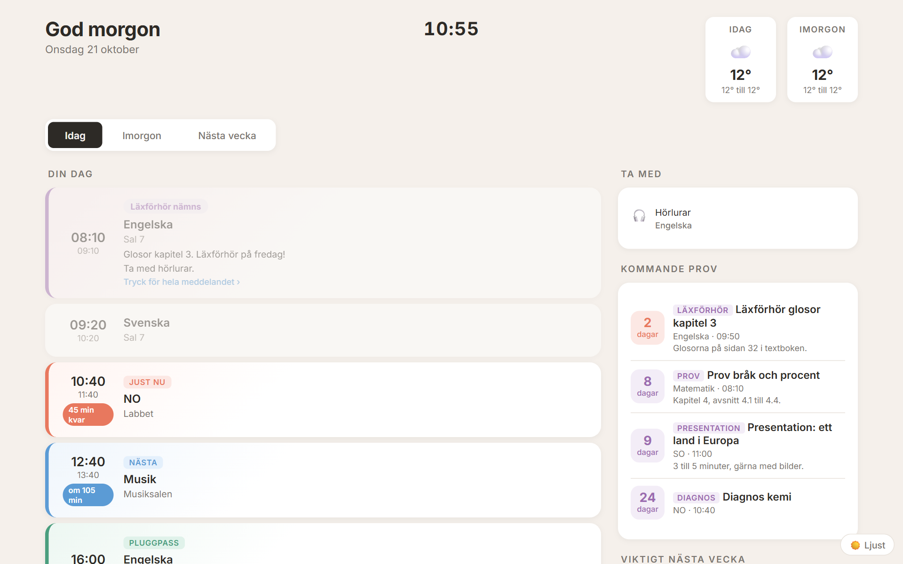
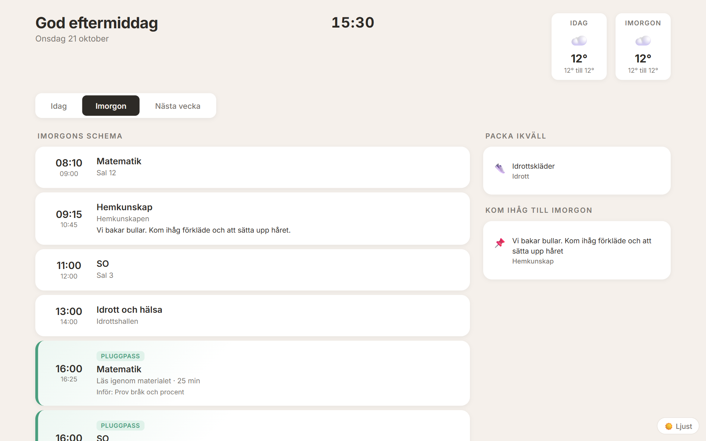
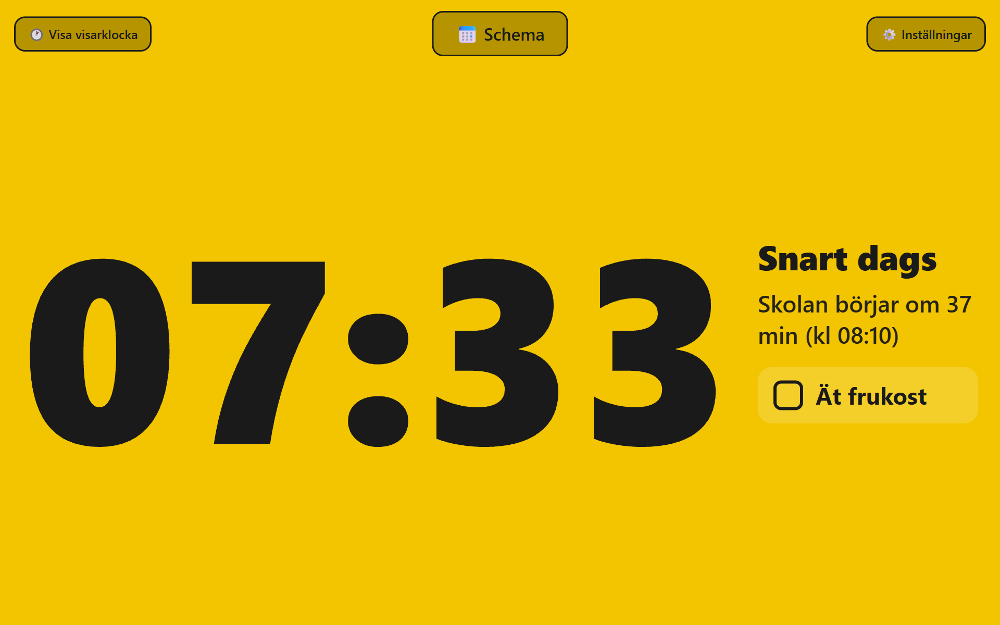

# School dashboard for kids who need structure

A calm, glanceable school dashboard for a child who benefits from visual structure (for example
with ADHD or dyslexia). It runs on a Raspberry Pi with a screen on the wall, or as a web page on
any computer in your home network.



| Afternoon: tomorrow and "pack tonight" | Morning: the get-ready clock |
| --- | --- |
|  |  |

*All screenshots use the built-in made-up sample data.*

It shows:

- **Today**: the day's lessons in order, with "now" and "next" highlighted and a countdown
- **Ta med** (bring): one merged packing list built from the teachers' notes (laptop, gym clothes, book...)
- **Kom ihåg** (remember): the other notes, without repeating what is already in the packing list
- **Upcoming tests** with a day countdown, and small daily 25 minute study sessions before each one
- **Tomorrow** (default after 12:00): tomorrow's schedule and "pack tonight"
- **Next week**: an overview with tests and important things on top
- **Weather** for today and tomorrow, and after-school activities
- **A "get ready" clock** for mornings: the screen turns green, yellow, orange, red as school start
  gets closer, each colour with 1 to 2 concrete tasks ("Ät frukost", "Borsta tänderna")
- Night mode: dark theme in the evening, a black screen at night

The interface text is in Swedish (it was built for a Swedish school). Translating it is a good first
task to give an AI assistant, see [docs/customizing.md](docs/customizing.md).

## Set it up with an AI assistant (recommended)

This repo is written so that an AI coding assistant (Claude Code, Cursor, Copilot, ChatGPT with
the files...) can read it and guide you step by step, even if you are not a programmer.

1. Get the code: `git clone https://github.com/jbmathisen/opsve-skol-dashboard.git` (or "Download ZIP" on GitHub)
2. Open the folder in your AI tool and say something like:

   > Read AGENTS.md and help me set up this school dashboard for my child.

The assistant will first run a demo with made-up data, then ask about your school platform and
hardware, and help you connect your real schedule. [AGENTS.md](AGENTS.md) contains the process
and the safety rules it must follow (for example: it never asks for your passwords).

## Try it yourself in 2 minutes

Needs Python 3.10 or newer.

```bash
pip install -r requirements.txt
python fetch.py        # builds web/school_data.json from made-up sample data
python server.py       # then open http://localhost:8080/dashboard.html
```

Add `?time=07:25` to `clock.html` to preview the morning clock at any time of day.

## How it works

```
your school platform ──> adapter ──> fetch.py ──> web/school_data.json ──> dashboard.html / clock.html
 (calendar feed, typed     (adapters/)  (+ weather,                         (only ever reads this file)
  timetable, or your own)               packing list, study plans)
```

The dashboard never talks to the school platform and never sees a password. A small script
(`fetch.py`) runs every few hours, asks an *adapter* for the schedule and writes one JSON file.

Three adapters are included:

| Adapter | Use when | Needs |
| --- | --- | --- |
| `sample` | trying it out | nothing (made-up data) |
| `manual` | your platform has no export, or you prefer not to automate a login | you type the weekly timetable into `timetable.json` |
| `ical` | your platform (or Google/Outlook calendar) offers a calendar subscription link | the link, in `.env` |

For other platforms you (with an AI assistant) write your own adapter from
[adapters/_template.py](adapters/_template.py). See [docs/adapters.md](docs/adapters.md).

## Documentation

| | |
| --- | --- |
| [AGENTS.md](AGENTS.md) | Guided setup process for AI assistants (and humans) |
| [docs/architecture.md](docs/architecture.md) | Files, data flow, what runs where |
| [docs/data-format.md](docs/data-format.md) | The `school_data.json` contract every adapter must produce |
| [docs/adapters.md](docs/adapters.md) | Connecting your school's schedule |
| [docs/raspberry-pi.md](docs/raspberry-pi.md) | Wall screen with a Raspberry Pi (kiosk mode, screen schedule) |
| [docs/web-setup.md](docs/web-setup.md) | Without a Pi: home computer, NAS or old tablet |
| [docs/customizing.md](docs/customizing.md) | Language, colours, activities, clock phases |
| [docs/design-principles.md](docs/design-principles.md) | Why it looks the way it does (ADHD and dyslexia friendly) |
| [docs/privacy.md](docs/privacy.md) | Keeping your child's data and your credentials safe |

## Privacy in one paragraph

Everything runs at home. Credentials live only in a local `.env` file, personal settings in
`config.json`, the fetched schedule in `web/school_data.json`: all three are git-ignored. Never
expose the dashboard to the internet, never commit those files, and never paste passwords into
an AI chat. Details in [docs/privacy.md](docs/privacy.md).

## På svenska

En lugn skärm för barn som behöver struktur i skoldagen: dagens lektioner, vad som ska packas,
kommande prov med nedräkning och en färgklocka för morgonen. Körs på en Raspberry Pi med skärm
eller som webbsida hemma. Öppna mappen i ett AI-verktyg och be det läsa `AGENTS.md`, så guidar
det dig genom installationen. Gränssnittet är på svenska. Dina inloggningsuppgifter och ditt barns
schema stannar hemma och checkas aldrig in i git.

## License

MIT, see [LICENSE](LICENSE). Not affiliated with any school platform.
